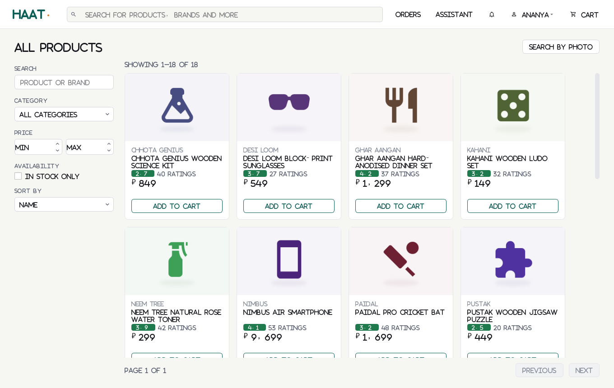

# Online Store Database

A simulated e-commerce backend (Django REST Framework + PostgreSQL) with AI services and a
PySide6 desktop client. Everything runs locally; one Python CLI drives it on Windows, macOS and Linux.

The demo store is **haat.**, an Indian online shop: prices in rupees (₹, Indian digit grouping,
inclusive of taxes), customers with Indian names and addresses in real localities with their PIN
codes, +91 mobile numbers, UPI / card / net banking / cash-on-delivery payments, and an Indian
festive calendar in the synthetic sales history. The UI follows a design made in Figma
(see section 7).

```
python store.py setup | seed | train | api | jobs | ui | test | screenshots
```



---

## 1. Quick start

Requirements: **Python 3.12+** and **PostgreSQL 16** (Docker or a local install). There is no SQLite
fallback: if PostgreSQL is unreachable, `setup` stops and tells you why.

### Linux / macOS

```bash
cd online_store
python3 -m venv .venv
source .venv/bin/activate
python store.py setup            # installs requirements, creates .env, checks PostgreSQL, migrates
# edit .env: DB_PASSWORD and the SEED_*_PASSWORD values, then re-run setup if the DB check failed
docker compose --env-file .env up -d     # or use a local PostgreSQL (section 2)
python store.py setup --no-install
python store.py seed             # ~40 s: 60 products, 600 customers, ~30k orders, reviews, promotions
python store.py train            # ~50 s: trains every model, writes ai/models/REPORT.md
python store.py api              # terminal 1: http://127.0.0.1:8000/api/  (Swagger: /api/docs/)
python store.py jobs             # terminal 2: background jobs (optional)
python store.py ui               # terminal 3: desktop client
```

### Windows (PowerShell)

```powershell
cd online_store
py -3.12 -m venv .venv
.venv\Scripts\Activate.ps1
python store.py setup
# edit .env (DB_PASSWORD, SEED_*_PASSWORD), start PostgreSQL (Docker Desktop or the EDB installer)
docker compose --env-file .env up -d
python store.py setup --no-install
python store.py seed
python store.py train
python store.py api      # keep running; open a second terminal for:
python store.py ui
```

### Demo accounts

Created by `seed` from `.env` (`SEED_ADMIN_EMAIL`, `SEED_STAFF_EMAIL`, `SEED_CUSTOMER_EMAIL` and their
passwords). Every generated customer uses `SEED_CUSTOMER_PASSWORD`.

| Role | Can do |
|---|---|
| Customer | catalogue, photo search, cart, checkout, orders, returns, SnapCheck, reviews, assistant |
| Staff | order queue, products & stock, review moderation, dashboard, analytics, segments, restock, AI insights |
| Admin (the seller) | everything Staff can, plus users & roles, discount rules and approval of AI discount drafts |

---

## 2. PostgreSQL

**Docker (all OSes):** `docker compose --env-file .env up -d` starts PostgreSQL 16 with the database,
user and password from `.env` and `max_connections=250`.

**Local install:**

- Linux: `sudo apt install postgresql` (or your distro's package), macOS: `brew install postgresql@16`,
  Windows: the EDB installer from postgresql.org.
- Create the role and database (or set `DB_ADMIN_USER`/`DB_ADMIN_PASSWORD` in `.env` and let
  `python store.py setup` create them):

  ```sql
  CREATE ROLE store_user LOGIN CREATEDB PASSWORD '<DB_PASSWORD from .env>';
  CREATE DATABASE online_store OWNER store_user;
  ```
  `CREATEDB` is needed because pytest creates a separate `test_online_store` database.
- **The concurrency test opens 100 simultaneous connections.** PostgreSQL's default
  `max_connections` is 100, so raise it: `ALTER SYSTEM SET max_connections = 250;` and restart
  PostgreSQL. `setup` prints a note if it is too low.

---

## 3. CLI reference

| Command | What it does |
|---|---|
| `python store.py setup [--no-install]` | pip-installs `requirements.txt`, copies `config/.env.example` to `.env` (with a fresh secret key), checks PostgreSQL (creates role/DB if admin credentials are given), runs migrations |
| `python store.py seed [--reset] [--scale 0.3]` | generates the synthetic world and loads it; `--reset` wipes all data first |
| `python store.py train [--only fraud,sentiment]` | trains models, refreshes segments/review analysis, writes `ai/models/REPORT.md` |
| `python store.py api` | Django development server on `API_HOST:API_PORT`; Swagger UI at `/api/docs/` |
| `python store.py jobs [--once JOB]` | APScheduler process: reservation cleanup, notifications, low-stock alert, discount suggestions, nightly training |
| `python store.py ui` | PySide6 desktop client |
| `python store.py test [pytest args]` | full test suite (needs PostgreSQL) |
| `python store.py screenshots [--record-fixtures]` | renders every screen offscreen into `docs/screenshots/`; starts the API if needed; `--record-fixtures` also records `ui/fixtures/` for mock mode |

---

## 4. Configuration (no hard-coded values)

| File | Contents |
|---|---|
| `.env` (documented in `config/.env.example`) | secrets, DB credentials, URLs, ports, demo accounts, LLM key/model, CLIP switch, UI base URL/timeout/token file, `UI_MOCK_MODE` |
| `config/business.yaml` | reservation window, token lifetimes, login rate limits, page sizes, payment methods & sandbox tokens, risk thresholds/OTP rules/fallback weights, minimum margin & discount limits, slow-mover thresholds, forecast horizon & backtest, safety stock (service level), segmentation labels, recommendation weights, fake-review weights, SnapCheck thresholds, report defaults, job schedules |
| `config/ml.yaml` | synthetic world (sizes, random seed, segments, seasonality, festivals, promotions, fraud function, reviews) and model hyper-parameters |
| `config/categories.yaml` | product taxonomy (Indian catalogue, fictional brands), product-type icons, price ranges in ₹, seasonality, review aspects |
| `config/india.yaml` | country, +91 mobile and PIN-code patterns, cities with real localities and PIN codes, building/road names, the 36 states and union territories, common names |
| `config/intents.yaml` | assistant intent templates and time phrases |
| `config/text_templates.yaml` | vocabulary for synthetic reviews |
| `config/theme.json` | brand name, palette (light/dark), fonts, radii, spacing, status-chip colours and labels; the Qt stylesheet is generated from it |

Role names live only in `backend/shared/roles.py`; order statuses and their allowed transitions
(per actor) live only in `backend/shared/order_states.py`.

---

## 5. Architecture

```
online_store/
  config/                    settings.py, loader.py, .env.example, *.yaml, theme.json
  backend/
    shared/                  roles, order state machine, hook contracts + default stubs, permissions, errors
    folder_one_core/         accounts, catalog, inventory, cart, reservations, orders, payments  (+ seed command)
    folder_two_services/     reports, discounts, reviews, risk, forecasting, segmentation,
                             recommendations, snapcheck, assistant, jobs  (+ seed extension)
  ai/                        generators, datasets, train_*.py, train.py (train_all), models/ (+ meta JSON, REPORT.md)
  ui/
    folder_a_shell/          shell, API client, QThread worker, base widgets, login, customer & staff screens
    folder_b_panels/         admin and AI panels (self-registering)
  tests/                     core/, services/, ui/
  docs/screenshots/          33 screenshots
  store.py  manage.py  docker-compose.yml  requirements.txt  requirements-clip.txt
```

**Hooks between the two backend workstreams.** Checkout calls `apply_discounts(cart)` and
`score_order(order)`, resolved by dotted path from `config/business.yaml → checkout.hooks`. Folder one
ships safe stubs in `backend/shared/hooks.py` (no discount, risk LOW); folder two provides the real
implementations (`discounts/engine.py`, `risk/scoring.py`). The hooks receive plain dataclasses from
`backend/shared/contracts.py`, not ORM objects. Core tests run against the stubs, service tests
against the real implementations. Seeding is split the same way (`config/business.yaml → seed.extensions`).

**UI panel registration.** `ui/folder_a_shell/registry.py` holds a page registry. Folder A screens and
folder B panels call `register_page(PageSpec(...))` at import time with their roles; the main window
builds the sidebar from the registry and never references folder B.

### Core commerce flow

1. **Cart** – persistent per customer; every response is priced on the server from current product
   prices plus the discount hook (client-sent prices are ignored).
2. **Reservation** – `POST /api/checkout/reserve/` locks inventory rows (`SELECT … FOR UPDATE`, ordered by
   product id) and holds stock for `reservations.window_minutes`. Availability is always
   `on_hand − active, unexpired reservations`, so expiry takes effect immediately on every read
   (lazy) and the `release_reservations` job marks expired rows.
3. **Checkout** – `POST /api/checkout/` with an `Idempotency-Key` header: one transaction locks inventory,
   re-checks stock, re-prices, snapshots prices into order items, decrements stock, consumes the
   reservation, scores risk. An expired reservation returns **410 `reservation_expired`**; a shortage
   returns **409 `out_of_stock`** with per-product details. Replaying the same key returns the same order.
4. **Risk** – score 0–100. MEDIUM → `VERIFICATION_REQUIRED` + simulated SMS OTP (delivered to the
   notification inbox); HIGH → `ON_HOLD` for staff review.
5. **Payment** – simulated gateway; outcome decided by sandbox tokens (`tok_visa`, `tok_declined`,
   `tok_insufficient`…). Payments are unique per (user, idempotency key); reusing a key with a different
   request returns 422.
6. **State machine** – every transition is validated against `order_states.TRANSITIONS` for the actor
   (role or SYSTEM) and recorded in `OrderStatusHistory`. Cancellation restocks and refunds; returns
   restock; COD cash is recorded on delivery.

Concurrency is proven by `tests/core/test_concurrency.py`: **100 threads buy the last 10 units at the
same instant → exactly 10 orders, 90 clean `out_of_stock` errors, stock 0.**

### Services (folder two)

| Feature | Endpoint(s) | How it works |
|---|---|---|
| Reports + CSV/PDF | `/api/reports/`, `/api/reports/<name>/?export=csv\|pdf`, `/api/reports/my-orders/` | 9 whitelisted report functions (`reports/functions.py`); reportlab PDFs |
| Discount engine | `/api/discounts/rules/` (+ `approve`, `reject`, `slow_movers`, `suggest`) | rules are JSON data (`conditions`, `action`) interpreted by a whitelist engine; codes or automatic; usage derived from order snapshots |
| Discount suggestions | `suggest` | slow mover = stock ≥ min, forecast ≤ max/day, days of cover ≥ min; elasticity per category estimated from past promotions in the order history; discount capped so price ≥ cost × (1 + min_margin); saved as DRAFT for Admin approval |
| Reviews | `/api/products/<id>/reviews/`, `/review-insights/`, `/api/reviews/moderation/` | verified-purchase flag, sentiment model, fake-review heuristics (duplicate text, bursts of unverified reviews, new accounts, rating/sentiment mismatch, short extreme), aspect pros/cons |
| Fraud risk | checkout hook, `/api/risk/overview/` | logistic regression / gradient boosting selected on validation; features: COD vs prepaid, account age, address mismatch, past refused deliveries, value, night order, history |
| Forecast & restock | `/api/forecasting/products/<id>/`, `/api/forecasting/restock/` | per-product model picked by rolling-origin backtest (moving average, seasonal naive, Holt-Winters, ridge on calendar/festival features); reorder point = avg daily demand × lead time + z·σ·√lead time |
| Segmentation | `/api/segments/summary/`, `/api/segments/customers/` | RFM (+ tenure, avg order value) → K-Means → loyal / big spenders / new / at risk |
| Recommendations | `/api/recommendations/`, `/api/products/<id>/similar/` | item-item collaborative filtering + TF-IDF content similarity + popularity, weights from config, with a reason string |
| SnapCheck & photo search | `/api/snapchecks/`, `/api/search/photo/`, `/api/snapcheck/status/` | image embedding similarity vs. listing photo; MISMATCH is fast-tracked to staff with a notification |
| Assistant & NL analytics | `/api/assistant/chat/`, `/api/assistant/analytics/`, `/api/assistant/actions/<id>/confirm\|cancel/` | Claude tool calling when `LLM_API_KEY` is set; otherwise the local intent classifier. Tools run as the logged-in user; data-changing tools become pending actions that need a confirm click; analytics only call whitelisted report functions |
| Jobs | `/api/jobs/runs/`, `/api/jobs/<name>/run/`, `/api/ai/models/` | APScheduler; every run is recorded |

There are 80 API routes. All of them except register, login, refresh and the schema/docs require
authentication; `tests/core/test_auth.py` walks the URL resolver and checks every one.

---

## 6. AI training

`python store.py seed` builds a synthetic world from `config/ml.yaml` (seeded, reproducible) with
learnable structure plus noise: customer segments with different rates, price affinity, category
taste and churn; weekly, monthly and festival peaks; promotions that add demand according to
per-category price elasticity; fraud from a hidden logistic function plus noise; review ratings
driven by latent product quality, with text sentiment that matches the rating (6% flipped); and
injected fake-review campaigns.

`python store.py train` (and the nightly job, which calls the same `ai.train.train_all`) trains
everything **from the database**, saves `ai/models/<name>.joblib` plus `<name>_meta.json` (date, data
hash, parameters, metrics), and writes **[ai/models/REPORT.md](ai/models/REPORT.md)**. Latest run
(**all metrics are on synthetic data**):

| Model | Metric | Model | Baseline |
|---|---|---|---|
| Fraud (logistic regression, selected) | average precision / ROC AUC | 0.500 / 0.895 | rules 0.438 / 0.880 |
| Sentiment (TF-IDF + LR) | accuracy / macro F1 | 0.928 / 0.906 | majority 0.603 / 0.251 |
| Forecasting (best per product) | WAPE on a held-out window | 0.700 | moving average 0.728 |
| Segmentation (K-Means) | silhouette / ARI vs hidden segments | 0.470 / 0.873 | quantile rules 0.420 / 0.692 |
| Recommendations (hybrid) | NDCG@10 / Precision@10 | 0.346 / 0.074 | popularity 0.217 / 0.046 |
| Intent classifier | accuracy on unseen phrasings (channel-aware) | 0.688 | keywords 0.531 |
| SnapCheck (fallback embedding) | ROC AUC / photo-search top-1 | 0.974 / 0.875 | random top-1 0.017 |
| Fake-review heuristics | precision / recall on injected fakes | 1.000 / 1.000 | – |

Exact numbers change slightly with the seed date; REPORT.md always shows the latest run.

**CLIP.** SnapCheck is designed for a pretrained CLIP model (`open_clip`, `requirements-clip.txt`). In the
build environment the Hugging Face hub was blocked, so **the lightweight fallback embedding (colour
histogram + gradient-orientation histogram + thumbnail) is what was tested and calibrated**. The active
method is shown in every SnapCheck response, the UI and REPORT.md. To use CLIP:
`pip install -r requirements-clip.txt`, keep `CLIP_ENABLED=true`, then re-run `python store.py train`
so thresholds are recalibrated for CLIP.

**LLM.** With `LLM_API_KEY` set, the assistant and analytics use Claude tool calling (`LLM_MODEL`,
default `claude-opus-5-5`). Without a key they use the local intent classifier. No key was available
here, so **the LLM path is implemented but has not been run**. If the LLM call fails at runtime, the
app falls back to the local classifier and says so in the response's `engine` field.

---

## 7. Desktop UI

**Design.** The screens were designed first in Figma
([design file](https://www.figma.com/design/Kr8GPYAEMlXzjD3KOxWhbD), page "Haat UI"). It has a
small design system (colour, type, buttons, status chips, inputs, product card) and six screens:
catalogue, product, checkout, your orders, Seller Hub dashboard and Seller Hub orders. The app
does not talk to Figma; `config/theme.json` carries the same tokens. The design aims for a calm,
practical look rather than a template look:
- one brand colour (deep teal) on a warm off-white background, with saffron used only in the logo;
- Inter at 400/500/600 weights, sentence-case labels, short copy and no explanatory subtitles unless
  a screen needs an instruction;
- text-only buttons (icons only where a button has no label), status chips with a dot and a
  sentence-case label, and charts drawn in a single colour;
- rupee amounts with Indian grouping (₹1,23,456, no paise when they are zero), compact chart axes
  (₹4.5 L, ₹1.3 Cr) and dates such as "21 Oct 2026" in India time.

**Layout.** Customers get a website-style header: logo, product search, links built from the page
registry (Orders, Assistant), notifications, an account menu (profile, notifications, dark mode,
sign out) and the cart with an item count. Staff and admins get the **Seller Hub**: a white sidebar
grouped into Overview, Store, Sales, Catalogue, Insights, Admin and Account, plus a top bar with
notifications and the signed-in person. Both are generated from the registry, so folder B panels
still appear without changes to the shell. Every screen has loading, empty and error states. All
API calls run in a `QThread` (`ui/folder_a_shell/worker.py`). A 401 triggers one token refresh; if
that fails, the app returns to the login screen with a "session expired" message.

- **Folder A (shell):** sign in / create account, account page with Indian address form (state list,
  6-digit PIN code and +91 mobile checks, also enforced by the API), catalogue with a filter rail
  (search, category, ₹ price range, in stock, sort) and product cards (brand, name, rating, price,
  stock note), search by photo, product page (price inclusive of taxes, stock and COD note, reviews
  with "what buyers mention", write a review, similar products), cart with server totals and coupon
  code, checkout (items held countdown, delivery address, UPI / card / net banking / COD with a test
  payment outcome, OTP, clear sold-out and expired-hold messages), your orders with order history,
  pay / cancel / return, photo check of a delivered item, notifications. Seller Hub screens: product
  form with validation, stock adjustment, photo upload, soft delete/restore; order queue that offers
  only the next steps the state machine allows and shows the risk score and reasons for orders on
  hold; photo-check review queue.
- **Folder B (panels, self-registering):** users and roles, discounts (approve/reject drafts, new
  rule), dashboard (KPIs, charts, CSV/PDF export with ₹ amounts), reviews moderation, customer
  segments, restock with forecast chart, assistant chat (confirm click before any action), "Ask the
  data" analytics, model health.

**Mock mode:** `UI_MOCK_MODE=true` makes the client replay `ui/fixtures/index.json`, which contains
responses recorded from a real API run (`python store.py screenshots --record-fixtures`). It never
invents data; requests that weren't recorded show "Not available in mock mode".

Screenshots of every screen are in [`docs/screenshots/`](docs/screenshots/).

---

## 8. Assumptions and decisions

- **Admin is the seller.** There is a single store, not a marketplace.
- **Reservations happen at checkout**, not on add-to-cart, so carts don't block stock. Add-to-cart still
  rejects quantities above current availability.
- **Payment happens inside checkout** when a sandbox token is supplied. A failed payment leaves the order
  PENDING, and the customer can pay later with a new idempotency key. COD orders go to CONFIRMED, and
  cash is recorded when the order is delivered.
- **"Address match"** compares the shipping address with the billing address (the default address
  unless another is chosen) by PIN code and country.
- **Indian context.** Prices are stored in rupees and are inclusive of GST, so no tax is added at
  checkout; the store time zone is Asia/Kolkata. Localities and their PIN codes are real; flat and
  building names are made up. Synthetic mobile numbers follow the Indian format (+91, starting 6–9)
  and are random, so they could belong to someone: they are stored locally only and the app never
  calls or texts anyone (OTP delivery is in-app). Synthetic emails use the reserved `example.com`
  domain. Brands are fictional. Festival dates in the synthetic history are approximate and fixed
  (real dates move with the lunar calendar). The fraud model's order-value feature is per ₹10,000,
  and the hidden fraud intercept was retuned so the fraud rate stays around 2–3%. Prices come from
  typical Indian retail ranges per product type (for example a smartphone ₹7,999–34,999, kajal ₹99–349).
- **Payments.** UPI, card and net banking are simulated prepaid methods; the sandbox token decides
  the outcome (the checkout shows it as "Test payment outcome"). Cash on delivery works as before.
- **OTP delivery is simulated.** The code is sent to the in-app notification inbox (the "SMS"). Too many
  wrong codes put the order ON_HOLD.
- **The risk score is the model probability rescaled** so that the configured review budget's share
  of orders lands at or above the HIGH threshold. When no model is trained, the config-weighted rules
  are used (and they are also the baseline).
- **Fraud labels** are `fraud_confirmed` (set by staff on the order) or a refused delivery.
- **Forecasts are precomputed** at training time for the maximum horizon (30 days); the API serves the
  configured horizon (14–30). The nightly job refreshes them.
- **Seeded orders predate the risk system**, so they have no risk score. Only orders that are still
  open get scored during seeding (with the rules, before any model exists).
- **Seed passwords:** one Argon2 hash is computed per password and reused for all generated customers,
  so seeding stays fast.
- **Login rate limiting** uses Django's local-memory cache. That works per API process, which is fine for
  this local, single-process app; a multi-process deployment would need a shared cache.
- **Media:** catalogue images are served by Django under `/media/products/`. Customer SnapCheck photos
  are only reachable through the authenticated API.
- **The synthetic history ends yesterday**, so no generated record lies in the future.
- **`python store.py api` uses Django's development server**, which is appropriate for a local simulation.

---

## 9. Status: what works and what does not

**Works (verified by tests or runs in this environment):** PostgreSQL schema & migrations; seed
(about 40 s); training of all models with REPORT.md (about 50 s); 55 automated tests passing (core,
services, an end-to-end seed→train→serve test, the 100-buyer concurrency test, and offscreen UI
tests); API smoke test over HTTP; the APScheduler process running interval jobs and the nightly
training job; 33 offscreen screenshots of every screen, reviewed for layout problems; mock-mode replay.
The Figma design file was built and checked screen by screen with Figma screenshots.

**Not verified / limitations:**
- **CLIP was not downloadable here**, so only the fallback embedding has been exercised and calibrated.
- **The LLM tool-calling path was not run** (no API key); the local-classifier path is tested.
- **Docker Compose was not run here** (no Docker daemon); development used a local PostgreSQL 16.
  `docker-compose.yml` follows the standard postgres image conventions.
- **Only Linux was tested.** The code avoids OS-specific calls (pathlib, the Python CLI, no shell
  scripts), but Windows and macOS were not tested directly.
- **The local intent classifier generalises moderately** to phrasings it has not seen (about 70%
  accuracy). Ambiguous requests get a clarifying question rather than an action.
- **Daily product-level demand is very noisy** (about 1–3 units/day), so forecast WAPE is high in
  absolute terms even though it beats the baseline.
- **All model metrics come from synthetic data** and say nothing about real customers.
